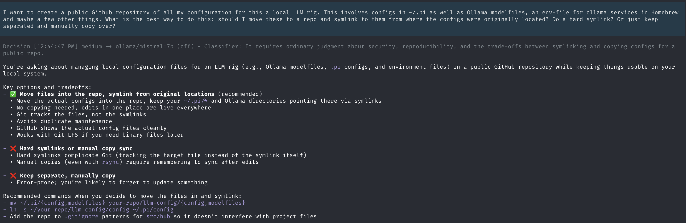
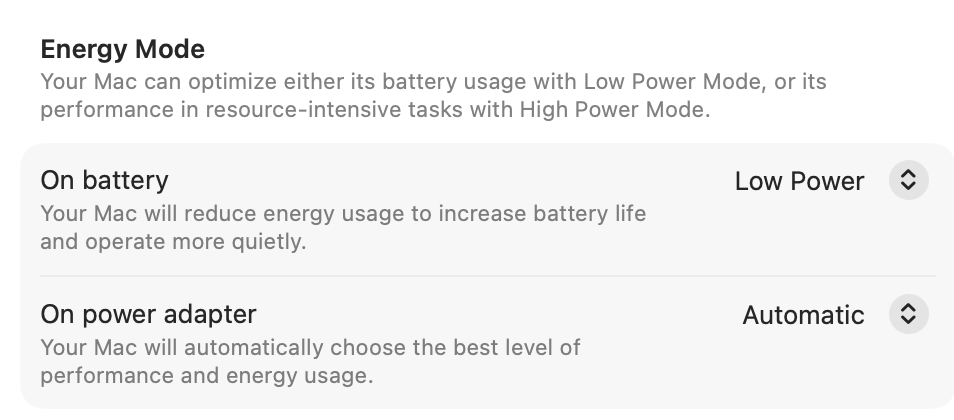

# My Local LLM Stack

This repository will track my configuration for a local LLM rig for small agentic programming tasks on my laptop.

**This configuration is being actively tweaked all the time. It will change frequently. Use it as a reference rather than an exact copy.**



If you don't know me, I'm an experienced software developer who has a somewhat skeptical view of LLM hype. There are many things I will never use an LLM for:

- Writing ADRs or other architectural decisions
- Writing anything else
- Crafting whole features from scratch
- Vibe coding
- Anything that I need to be very aware of
- Anything I am personally responsible for
- Anything where I could learn something from doing it.

If you want a longer version of this ethos, you can read of few of my blog posts:

- [Why I Don't Vibe Code](https://jacobharr.is/personal/i-dont-vibe-code.html)
- [The LLM Is Not a Junior Engineer](https://jacobharr.is/personal/llm-not-junior-engineer.html)

Simply put, LLMs are an over-hyped technology with a lot of risks for people and
the planet. However, I do feel like I need to understand the underlying
technology both to demystify it and because my future career prospects might
depend on it. And it does seem clear that the one area that LLMs do best in is software
development. 

So, I've spent the last few months tinkering on a local LLM setup for agentic
coding that can run comfortably on my laptop. This is my local configuration. It
probably has bugs or things that are dumb or things I will tweak. The world of
local LLM configurations feels a bit like audiophile spaces: no matter what you
are doing, someone will tell you that you're doing it wrong. And I probably am!
Use at your own risk.

But, I have been using it for some things where I do want to let the LLM run with tasks. Some recent examples:

- Look through this codebase and find all the areas where I have `# FIXME`
  comments. Collect them in a report and analyze if any no longer apply.
- Improve the test coverage for this file to be above 90%
- Update the openapi spec for this project in the repo to match what the API
  actually implements today
- You are not allowed to run Docker. Figure out how to run the test suite here
  that normally calls a Docker image to run it locally instead. You will likely
  need to experiment with the PYTHONPATH to get it to work.
- Replace all of the Django REST Framework serializers in this project to use
  `drf-pydantic` instead.

What I've found works best for the agent and my own comfort are focused tasks
with clear deliverables (even if it's just answer why this is or isn't a good
idea) that can run for maybe about half an hour or so. In general, it's often a
good idea to ask the agent to generate a plan first and then execute on it,
although I often skip that if the task is relatively clear and the files are all
in version control already on a separate branch (I don't let the agent merge
branches). This is the LLM-agent augmentation that works for me, following the
analogy that I would use a forklift to move crates in a warehouse, but [it would
be terrible for my health to use a forklift at the
gym](https://teachinginhighered.com/podcast/an-e-bike-for-the-mind-ai-augmentation-and-moral-hazards-with-josh-brake/).

## Why a Local Rig?

I could use a cloud-hosted LLM/IDE combo like Claude or Codex, but I prefer not to for several reasons:

- I'm cheap and don't like spending money on compute if I can avoid it.
- I like being able to tinker with it locally
- I prefer the privacy of a private model
- I don't like the ethics of how these models were made
- I don't like the ethics of how these data centers operate
- I don't like the ethics of how these businesses work
- I don't want to be dependent on a product that is being artifically discounted
- Did I mention I'm cheap?

There is a lot of "I" in that list, and that's the point. These are my personal
reasons. I have no interest in debating the correctness of this list; this is
just my own personal guidelines that framed this problem for me.

I also have not rigorously compared the options and benchmarked them, etc.
Because I don't really care that much. Local LLM tweaking has the same vibes as
premium audiophiles and camera collectors; everybody has their own opinions on
what the optimal configuration is. I don't pretend that this framework is
optimal. I am merely providing it as an example.

As an aside, it does seem like there could be a good business/neighborhood
service of running locally hosted models as a service. These machines would need
to have massive amounts of memory to handle multiple models with parallel
connections.

## My Laptop

I replaced my old MacBook Pro with a newer one this year and decided to get one
with a lot more memory than I usually have had in the past, because RAM is
really the most important. At the same time, it's ludicrous how expensive a
laptop these days can be if you try to max out the memory or hard drive.
Ultimately, I decided to pick a compromise with the thinking that constraints
often are a good way to clarify options and that if I really got into this
model, I could buy a maxed out Mac Mini or something and host models there. Or
an ethical cloud LLM might emerge that I'm fine paying for (_this seems like it
could be a good boutique business or neighborhood tech service_)

My machine is a 14" MacBook Pro with an M5 Pro chip and 48GB of memory, which
retailed for about $2500 before Apple hiked prices because of RAM shortages.
Just enough memory to do some interesting medium models (30b or lower) but
constrained enough that I need to make choices too. If you want to run even
bigger models or have more resident in memory simultaneously, definitely get
more RAM than me.

## My Coding Harness

I chose the [Pi Coding Framework](https://pi.dev/) because it is the most
minimal framework out of the box with a large number of extensions. This matters
to me because I wanted to tweak some things like model routing, etc. but also I
am running models on my machine that might not have a large context window. If
you are a beginner to all this and want to use a cloud model or single model
locally with a large context window, forks like
[oh-my-pi](https://github.com/can1357/oh-my-pi) come with more batteries
included. But OMP's SYSTEM prompt (the first thing sent to the LLM model) is 20k
tokens. Pi's is a lot smaller.

There is a risk to using a minimal framework. It offers no safety guardrails out
of the box. I appreciate the honesty here and use an external program to run pi
in a sandbox, but you should be careful if you are running pi locally without
any protections.

## The Model Router Approach

Originally, I wound up manually switching between a few differently sized models
to get a feel for it. More recently, I have switched to a "model router"
configuration where code looks at the complexity of the incoming task and makes
a decision which model to route it too. First, it sees if there is a regexp
match and then it'll use a tiny little classifer model to examine the task complexity if
that task fails.

This configuration is highly experimental and likely to change as I observe its
performance and tweak parameters. There is going to be a lot of tweaking,
because I'm trying to do a few different optimizations at once!

If you look at the [internal code for the pi-model-router I'm using](https://github.com/yeliu84/pi-model-router/blob/b919a041f30e60e7c34c216e5a1e453359e24e2d/extensions/routing.ts#L144), it's pretty sophisticated in how it makes a routing decision:

1. First look to see if the user has pinned a specific tier
2. Then try to see if we can match one of the user-defined rules
3. Otherwise, try to see if we can match some internal heuristics even if the user didn't define their own rules
4. Finally, if all else fails, ask the classifier.

In addition, there is some logic to support "stickiness" in routing decisions.
The problem of switching between models is that the model you switch to has to
ingest all of the context of the conversation first to get up to speed. Ollama's
internal caching helps with that when doing multiple turns with the same model,
but when switching to a different model, it has to catch up on all the stuff the
other model did since the new model last ran. "Ping-ponging" between two models
can actually be worse because of this, so it's sometimes good to just stick to
the same model for multiple turns regardless of the task complexity.

The problem here is that the biggest model I have is much slower than the other
two. I want stickiness in general, but not for that. I also want it to only be
invoked when there are things that the middle and lower tiers can't handle that
well. So, you'll see me doing some tweaks over time to try to make it so the
lower models handle 80% of the tasks with the big model swapping in for when
it's really needed and hopefully exiting immediately after.

## The Classifer Model

When all regexps miss, the model router will then ask a classifier model to assess which model will run this. Here is the code for the prompt it sends:

```typescript
const TIER_CRITERIA: Record<RouterTier, string> = {
  high: 'Architecture, design, planning, tradeoff analysis, broad debugging, large refactors, or codebase research',
  medium:
    'Implementation of a known plan, multi-file edits, normal coding work, focused debugging, or tests/fixes',
  low: 'Summaries, changelogs, formatting, quick explanations, small bounded transforms, or simple read-only lookups',
};

const classifierPrompt = `You are a model router classifier. Your job is to categorize the user's latest request into one of three tiers: "high", "medium", or "low".

Tiers:
- high: ${TIER_CRITERIA.high}.
- medium: ${TIER_CRITERIA.medium}.
- low: ${TIER_CRITERIA.low}.

${currentPhase ? `Current conversation phase: ${currentPhase}\n` : ''}
Recent history:
${historyText}

Latest user message:
${promptText}

Return your decision in exactly two lines:
Tier: [high|medium|low]
Reasoning: [one short sentence]

${currentPhase === 'planning' ? 'Consider that the conversation is currently in a planning phase. Bias toward "high" unless the request is clearly a simple implementation or summary.' : ''}
${currentPhase === 'implementation' ? 'Consider that the conversation is currently in an implementation phase. Bias toward "medium" unless the request is clearly planning or a simple summary.' : ''}`;

```

To handle these, I have another classifier model which is a very smol model that is tuned to just take these and not use a ton of memory (0.5 GB or so). I do this with a highly-tuned Modelfile you can see in the Ollama directory.

## The Problems of an "Ethical" Model

Now that I had a machine, the next step was finding an ethical model for coding
purposes. Basically, I wanted something that wasn't built from indiscriminate
scraping, that respected robots.txt and had standards for transparency and
governance. It had to provide open models I could download and run on my
machine.

Funnily enough, the best provider (by a wide margin in the [Stanford Foundation
Model Transparency
Index](https://crfm.stanford.edu/fmti/December-2025/index.html)) is [IBM's
Granite](https://research.ibm.com/blog/granite-ethical-ai). Yes, that IBM. The
one that [asked Douglas Crockford in 2011 for an exception to a "the software
shall be used for good, not evil" license
clause](https://en.wikipedia.org/wiki/JSLint). What happened? It turns out that
corporate AI customers aren't too keen on the possibility that a software LLM
might regurgitate copyrighted or license-restricted code. And so, IBM built its
models around using licensed code only. Which meant that it had ethically
sourced data and full governance over its training data. Add some other
transparency into training and practices, and you are well on the way.

From this perspective, it's no surprise that the second and third companies of
the Stanford list also specialize in LLMs for corporate clients in
heavily-regulated industries. Since I wanted reasoning, I picked two IBM models
for my rotation with reasoning and more optimizations for agentic coding:

- Granite4.2-8B
- Granite4.2-30B

The 8B model can do many simple programming tasks (like searching through syntax
trees or renaming functions). The 30B is able to do deeper reasoning, but it
comes with a really heavy memory footprint that makes it ponderous and slow on
local hardware. There is a missing spot in the middle between those two.

For that, I've turned to [Devstral Small 2](https://mistral.ai/news/devstral/),
a 24B model from Mistral that is trained on coding data. It is NOT as ethically
transparent as Granite (they keep their training sources secret), but it is
supposed to be trained on Github repositories and follow European regulations.

I also am evaluating the [Recursive Flint](https://recursive.com/updates/introducing-recursive-flint) Mixture of Experts model instead of Devstral.
What I like about it is that it supports thinking mode and uses a Mixture of
Experts approach to be usable on laptops, etc. I'm not sure about how its data
was sourced however. I also am not keen that they are using the idiotic "Super Intelligence" terminology now. It is pretty fast for lower tiers though.

In any event, I'll keep revising as I see fit and new models are released.

## Making It All Fit

On a MacBook Pro, your biggest constraint on the models you can run is the size
of your memory. Yes, more GPUs will make things run faster, but ultimately the
memory is the most important factor. Macs have one advantage in that they have a
unified memory pool which can be used by CPU and GPUs, making it easier to use
parts of it for LLMs. But, you also need memory to run other apps and operating
system stuff so you need to keep memory consumption low enough to avoid frequent
swapping to disk (which will tank your performance).

There are several ways in which you can adjust memory consumption of models:

1. The model itself is sized based on the number of parameters (8B = 7 billion),
   but open-weight models often come with different options to represent the
   precision of the internal values used by the model. Models are usually
   trained with 16-bit floats for each parameter. Switching or _quantizing_ to
   8-bit will half the memory consumption (with a relatively minimal reduction
   in accuracy). Reducing to 4-bit will halve it again (with a possibly larger
   effect on accuracy). Many laptop models are installed with 4-bit precision.
2. The model file just stores the fixed weights, to actually use the model, you
   need to also have a K_V cache which represents the current computation
   against the model. That too can be scaled at different levels of precision
   which can take different memory footprints, but essentially it doubles the
   memory footprint of the model itself. Since it represents the state of the
   current model, you need to have multiple K-V caches in memory if you want to
   run multiple subagents of the same model in parallel.
3. Context window represents the amount of context that the model can keep in
   its attention. Longer context is generally better for handling multiple files
   or complex reasoning, but sometimes smaller parameter models can do worse
   with larger contexts. Most models you download will have default contexts of
   128K or higher. You might need to tweak the context window you launch with.

For an example, here is the memory footprint of the Granite 30 model with
parameter adjustments at 65k context window

|Quantization Level|Model Weights VRAM|KV Cache VRAM|Total VRAM Required|
|------------------|------------------|-------------|-------------------|
|Q16 (BF16 / FP16) |\~53.83 GB        |\~15.87 GB   |\~69.70 GB         |
|Q8 (Int8)         |\~26.92 GB        |\~7.93 GB    |\~34.85 GB         |
|Q4 (Int4)	       |\~13.46 GB        |\~3.97 GB	|\~17.42 GB         |

And here is what adjusting the context window is for a Q4 model

|Context Window Size|Model Weights VRAM|KV Cache VRAM|Total VRAM Required|
|-------------------|------------------|-------------|-------------------|
|131,072            |\~13.46 GB        |\~7.81 GB    |\~21.27 GB         |
| 65,536            |\~13.46 GB        |\~3.91 GB    |\~17.37 GB         |
| 32,768            |\~13.46 GB        |\~1.95 GB    |\~15.41 GB         |
| 16,384            |\~13.46 GB        |\~0.98 GB    |\~14.44 GB         |

For the models I picked, I wanted to be able to keep my worker/orchestration
model (the Granite 8B) in memory alongside my default coding model (the Devstral
one). I was fine if both had to be ejected from memory for the 30B to do a deep
computation with a lot of context. I went for 4-bit quantization on all my
models, so it was ultimately a case of tweaking context windows for each model.
This is what I chose (for now).

|Model           |Context Window|Total Memory|
|----------------|--------------|------------|
|Granite 8B      |65,536        |8.5 GB      |
|Devstral 2 Small|131,072       |20 GB       |
|Granite 30B     |131,072       |27 GB       |

This means I usually have about 28 GB or so allocated to the model and the rest
for apps/system. It can take a few seconds to switch between using the 30B and
the other models (or back), but that's the price I pay for using a local setup
and I'm fine with it myself. It's harder for an agent to pull a fast one when an
agent isn't that fast.

Which reminds me, what kind of performance am I seeing? It varies depending on
model size and the size of the context window, but I'm usually pulling about
1000+ - 100 tokens/second for reading and 15-6 tokens/second for generation.
Again, this doesn't approach the speed of cloud models, but I'm not running a
data center.

For those of you who know LLMs, you know that each prompt actually runs the
whole computation with the previous context and what you added to get new
completions. One nice thing about Ollama is that it has a token cache which can
recognize the same token preamble as before and skip the tedious ingestion of
the old content again.

This works for the most part, but I'll probably keep tweaking it. One unusual
aspect of this setup is that the Granite models can support reasoning, but the
Devstral one doesn't. So I have a thinking sandwich basically, and it feels like
it would make sense to turn off thinking for the low Granite-8b model and find a
thinking alternaitve to Devstral that works well for development.

## No Subagents

My stack can run at most 2 models at a time. This means that workflows and tools
that rely on dozens or hundreds of subagents will be effectively throttled. I'm
good with that, but just noting for context.

It also means that I can't run Pi against two different projects at the same
time (I don't have support for parallel models and it would kill caching, etc.)
I accept this, because I like to give my agents really specific tasks and focus
on their work without obsessing about hitting new theoretical performance
maximums. I accept this is a limitation of this approach, but it might be a
dealbreaker for you. I do recommend using frameworks like `/goal` or `/loop`
that can resume in the middle of the work if you do need to kill your agent in
one project to go work in another.

## Configurations

Ths directories in this repository contain various configuration options I am
using as well as additional README files.

- **Ollama**: Ollama modelfiles to tweak my models and important env vars
- **Pi**: these are my configurations for Pi (usually from ~/.pi)
- **Fence**: my guardrails for the agent (usually in ~/.config/fence/fence.json)
- **Emacs**: my config for calling up a Pi window in Emacs

## How I Run Pi

Because I use `fence`, I invoke pi with an shell alias to `fence pi`. In actuality, I really invoke with an alias to `fence -m --fence-log-file ~/code/tmp/fence-denials.log -- pi` so I can see what stuff is being blocked and revise my config as needed.

# One Other System Setting

If you want to use LLMs while your laptop is unplugged, you should set the
Battery setting to use Low Power when on battery power only. Otherwise, your
fans will be blowing like crazy and your battery charge will drop fast. This
does mean a performance hit (and your laptop gets warm), but it's still
reasonable.


